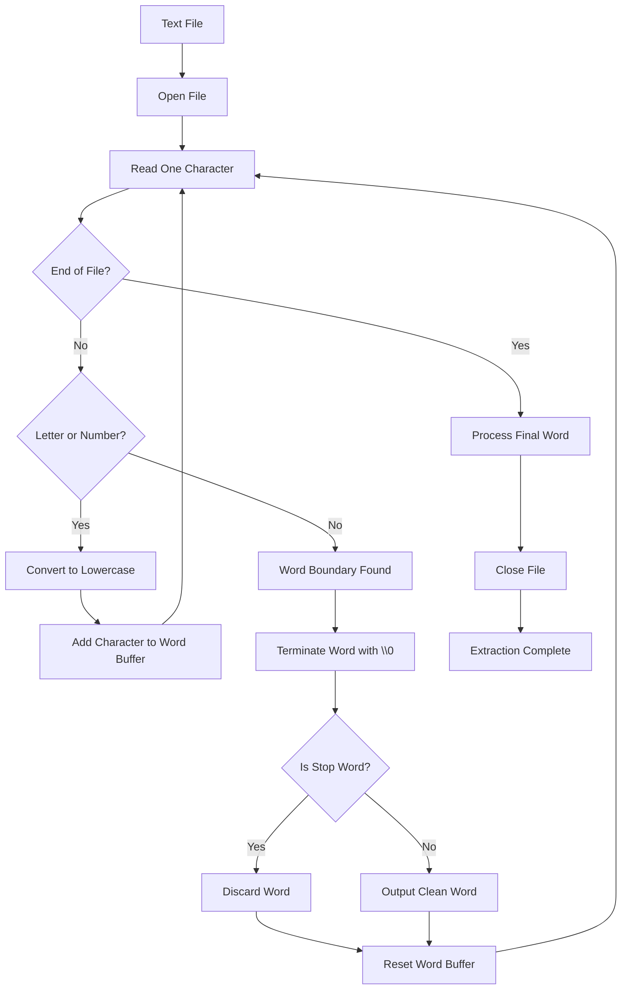

# Text Extraction Module

## 1. Purpose

The Text Extraction Module is the **first processing stage** of FINDX.

Its job is simple:

> **Read a document and produce clean individual words that can be given to the indexing system.**

The extractor does **not** build the hash table or linked lists yet.

Keeping extraction separate from indexing makes the project easier to understand, test, and maintain.

---

# 2. Current Input and Output

### Input

A text file such as:

```text
Machine learning is useful for data science.
Machine learning uses Python and data.
```

### Raw characters

The program reads:

```text
M a c h i n e [space] l e a r n i n g ...
```

### Clean output

```text
machine
learning
useful
data
science
machine
learning
uses
python
data
```

Basic stop words such as:

```text
the
is
a
an
and
or
of
to
in
on
for
```

are removed.

---

# 3. Module Flowchart



---

# 4. Why Read Character by Character?

The first implementation uses:

```c
fgetc(file)
```

This reads one character at a time.

For:

```text
Machine learning
```

the program sees:

```text
M
a
c
h
i
n
e
(space)
l
e
a
r
n
i
n
g
```

This makes word-boundary detection easy.

A space, punctuation mark, or other non-alphanumeric character tells us that the current word has ended.

---

# 5. Basic Algorithm

```text
Open file

Create empty word buffer

While there are characters:
    Read one character

    If character is a letter or number:
        Convert to lowercase
        Add it to current word

    Otherwise:
        If a word was being built:
            End the string
            Check stop-word list

            If it is not a stop word:
                Pass/output the word

            Clear word buffer

Process final word

Close file
```

---

# 6. File Structure

The module uses two files:

```text
text_extractor.h
text_extractor.c
```

The rest of the application can call the extractor without needing to know its internal implementation.

---

# 7. `text_extractor.h`

```c
#ifndef TEXT_EXTRACTOR_H
#define TEXT_EXTRACTOR_H

void extract_text(const char *filename);

#endif
```

## `#ifndef`

```c
#ifndef TEXT_EXTRACTOR_H
```

Checks whether `TEXT_EXTRACTOR_H` has already been defined.

This is part of an **include guard**.

## `#define`

```c
#define TEXT_EXTRACTOR_H
```

Defines the guard so that the header is not included repeatedly.

## Function declaration

```c
void extract_text(const char *filename);
```

Declares the function that other files can call.

Example:

```c
extract_text("doc1.txt");
```

The function returns nothing, so its return type is `void`.

## `#endif`

Closes the include guard.

---

# 8. `text_extractor.c`

## Libraries

```c
#include <stdio.h>
#include <string.h>
#include <ctype.h>
#include "text_extractor.h"
```

### `stdio.h`

Provides:

```c
FILE
fopen()
fgetc()
fclose()
printf()
```

### `string.h`

Provides:

```c
strcmp()
```

which is used to compare strings.

### `ctype.h`

Provides:

```c
isalnum()
tolower()
```

for character processing.

### `text_extractor.h`

Includes our own function declaration.

---

# 9. Stop Words

```c
const char *stop_words[] = {
    "the", "is", "a", "an", "and",
    "or", "of", "to", "in", "on",
    "for", "with", "this", "that",
    "are", "was", "were", "it"
};
```

This is an array of strings.

These words are treated as basic stop/filler words.

Conceptually:

```text
stop_words
     |
     +--> "the"
     +--> "is"
     +--> "a"
     +--> "an"
     +--> ...
```

The list can be expanded later.

---

# 10. Counting Stop Words

```c
#define STOP_WORD_COUNT \
    (sizeof(stop_words) / sizeof(stop_words[0]))
```

`sizeof(stop_words)` gives the total size of the array.

`sizeof(stop_words[0])` gives the size of one element.

Therefore:

```text
total size / one element size
```

gives the number of elements.

This means we don't have to manually update the count whenever the list changes.

---

# 11. `is_stop_word()`

```c
int is_stop_word(const char *word)
{
    for (int i = 0; i < STOP_WORD_COUNT; i++)
    {
        if (strcmp(word, stop_words[i]) == 0)
        {
            return 1;
        }
    }

    return 0;
}
```

The function receives a word and returns:

```text
1 → word is a stop word
0 → word is not a stop word
```

## Loop

```c
for (int i = 0; i < STOP_WORD_COUNT; i++)
```

Checks every stop word.

## Comparison

```c
strcmp(word, stop_words[i]) == 0
```

`strcmp()` returns `0` when both strings are equal.

Example:

```c
strcmp("the", "the") == 0
```

Therefore the function returns `1`.

If no match is found, it returns `0`.

---

# 12. Opening the File

```c
FILE *file = fopen(filename, "r");
```

`fopen()` opens the file.

The `"r"` means **read mode**.

For:

```c
extract_text("doc1.txt");
```

the program attempts to open:

```text
doc1.txt
```

The returned `FILE *` is used by the program to read the file.

---

# 13. File Error Handling

```c
if (file == NULL)
{
    printf("Error: Could not open file.\n");
    return;
}
```

If the file cannot be opened, `fopen()` returns `NULL`.

The function prints an error and stops.

---

# 14. Word Buffer

```c
char word[100];
```

This temporary array stores the word currently being built.

For example, while reading:

```text
Machine
```

the buffer becomes:

```text
M
Ma
Mac
Mach
Machi
Machin
Machine
```

The current implementation supports words up to 99 characters plus the terminating `'\0'`.

---

# 15. Character Position

```c
int index = 0;
```

`index` tells us where the next character should be placed.

Example:

```text
word[0] = 'm'
word[1] = 'a'
word[2] = 'c'
```

After storing each character, the index increases.

---

# 16. Current Character

```c
char ch;
```

Stores the character currently being read.

---

# 17. Main Reading Loop

```c
while ((ch = fgetc(file)) != EOF)
```

`fgetc()` reads one character.

The loop continues until `EOF` (End Of File) is reached.

For:

```text
Machine learning
```

the loop processes:

```text
M → a → c → h → i → n → e → space → l → ...
```

---

# 18. Checking the Character

```c
if (isalnum((unsigned char)ch))
```

`isalnum()` checks whether the character is:

- a letter, or
- a number.

Examples:

```text
M  → yes
a  → yes
7  → yes
space → no
. → no
, → no
```

The cast to `unsigned char` is used safely with the `<ctype.h>` functions.

---

# 19. Preventing Buffer Overflow

```c
if (index < 99)
```

The buffer has size 100:

```c
char word[100];
```

We reserve the last position for:

```c
'\0'
```

so the maximum stored character position is 98.

---

# 20. Adding a Character

```c
word[index++] = tolower((unsigned char)ch);
```

This does two things.

First:

```c
tolower(ch)
```

converts uppercase letters to lowercase.

Example:

```text
M → m
P → p
```

Second:

```c
word[index++]
```

stores the character and then increases `index`.

So:

```text
Machine
```

becomes:

```text
machine
```

---

# 21. Detecting the End of a Word

If the character is not alphanumeric, we reach:

```c
else
```

For example:

```text
Machine learning
       ^
     space
```

The space tells us that `"Machine"` has ended.

---

# 22. Checking Whether a Word Exists

```c
if (index > 0)
```

This prevents the program from processing empty strings caused by multiple spaces or punctuation.

---

# 23. Terminating the C String

```c
word[index] = '\0';
```

This is essential in C.

C strings end with the null character:

```text
'\0'
```

For `"machine"` the memory conceptually becomes:

```text
m a c h i n e \0
```

Without `'\0'`, C does not know where the string ends.

---

# 24. Stop-Word Check

```c
if (!is_stop_word(word))
{
    printf("%s\n", word);
}
```

The `!` means NOT.

Therefore:

```text
is_stop_word() = 1
    ↓
!1 = 0
    ↓
Do not print
```

and:

```text
is_stop_word() = 0
    ↓
!0 = 1
    ↓
Print the word
```

---

# 25. Resetting the Buffer

```c
index = 0;
```

After processing one word, the program starts building the next word from the beginning of the buffer.

---

# 26. Final Word

After the loop reaches `EOF`, the last word might not have been followed by a space or punctuation.

Therefore the code processes the remaining word again:

```c
if (index > 0)
{
    word[index] = '\0';

    if (!is_stop_word(word))
    {
        printf("%s\n", word);
    }
}
```

This prevents the final word from being lost.

---

# 27. Closing the File

```c
fclose(file);
```

Once reading is complete, the file is closed.

This releases the resources associated with the opened file.

---

# 28. Current Full Flow

```text
                    ┌─────────────┐
                    │  doc1.txt   │
                    └──────┬──────┘
                           │
                           ▼
                    ┌─────────────┐
                    │  fopen()    │
                    └──────┬──────┘
                           │
                           ▼
                    ┌─────────────┐
                    │   fgetc()   │
                    │ read 1 char │
                    └──────┬──────┘
                           │
                           ▼
                    ┌─────────────┐
                    │ Letter or   │
                    │   number?   │
                    └──┬──────┬───┘
                     Yes      No
                      │        │
                      ▼        ▼
                 lowercase   word
                 + buffer    complete
                      │        │
                      │        ▼
                      │   add '\0'
                      │        │
                      │        ▼
                      │   stop word?
                      │      /   \
                      │    Yes    No
                      │     │      │
                      │   discard  clean
                      │            word
                      │              │
                      └──────┬───────┘
                             ▼
                       reset buffer
                             │
                             ▼
                         read next
                             │
                             ▼
                            EOF
                             │
                             ▼
                       close file
```

---

# 29. Important Design Decision

At this stage, the extractor **does not create the linked list**.

Currently it does:

```c
printf("%s\n", word);
```

Later this will change.

Instead of:

```text
clean word
   ↓
printf()
```

we will have:

```text
clean word
   ↓
index_word()
   ↓
Hash Table
   ↓
WordNode
   ↓
Document Linked List
```

For example:

```text
doc1.txt
   │
   ▼
Text Extractor
   │
   ├── machine
   ├── learning
   ├── useful
   └── data
          │
          ▼
      Indexer
          │
          ▼
    Hash Table
          │
          ▼
      "machine"
          │
          ▼
       D1 → NULL
```

When `doc2.txt` is indexed:

```text
"machine"
    │
    ▼
D1 → D2 → NULL
```

This separation is intentional:

```text
Extractor = "What are the words?"
Indexer   = "Where do those words belong?"
Searcher  = "Which documents match my query?"
Ranker    = "Which matching documents should appear first?"
```

---

# 30. Future Improvements

The first extractor is intentionally simple.

Later it can support:

- Better stop-word handling.
- Configurable stop-word lists.
- Unicode text.
- Better punctuation handling.
- Hyphenated words.
- Numbers.
- File metadata.
- Multiple file types.
- PDF extraction.
- Streaming large files.
- Passing tokens directly to the indexer instead of printing them.

The next implementation step is to replace the `printf()` output with an interface that passes each clean word to the **inverted-index module**.
